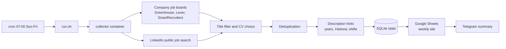

# job-finder

A small self-hosted service that collects new DevOps, NOC and IT support job postings in Israel every working morning, filters them against my profile, picks which of my four CVs fits each role, and appends the results to a Google Sheet. A short summary arrives in Telegram when the run finishes.

It runs as a one-shot Docker container on a Raspberry Pi 3, started by cron from Sunday to Friday at 07:00. The Friday run brings Thursday's postings in time for sending CVs, the Sunday run covers the weekend.

## Why

Applying for entry-level infrastructure roles means checking LinkedIn and a dozen company career pages every day. I wanted that part automated, so the routine becomes: open one sheet on Friday, send CVs in bulk, and track the replies during the week.

## How it works



1. **Search window.** Each run starts from the last successful run minus one hour of overlap, capped at seven days. A Sunday run therefore covers the weekend, and a day when the Pi was off is picked up by the next run.
2. **Sources.** Public job board APIs of selected companies, plus the public LinkedIn job search for a list of keywords, with random pauses between requests and exponential backoff on HTTP 429 and 5xx answers.
3. **Classification.** Regular expressions on the job title drop senior, management, student and unrelated roles, choose one of four CVs (`DevOps`, `NOC`, `IT_Support`, `Technical_Support`) and give a score from 1 to 3.
4. **Deduplication.** Inside a run, the same posting found on LinkedIn and on the company site is kept once, and the company site wins. Across runs, a SQLite table of delivered jobs filters out anything already sent, by URL or by normalised company and title.
5. **Hints.** The full description is scanned for required years of experience, Hebrew requirements and shift work. Roles asking for more than four years drop to score 1.
6. **Delivery.** New rows are appended to this week's tab in Google Sheets, then a summary goes to Telegram. Jobs are marked as seen only after the sheet write succeeds, so a failed run is retried in full the next morning.

## The sheet

One tab per working week (`22–26 Nov`). A new week starts as a copy of the previous tab, so formatting, filters and drop-downs carry over.

| Columns filled by the script | Columns filled by me |
|---|---|
| Added, Posted, Company, Role, City, Link, Source, CV, Score, Also in, Notes | Status, Sent on, Comments |

The script only ever appends rows and never writes to the last three columns, so manual statuses are safe between runs.

## Telegram summary

```
Job Finder — Mon 23 Nov, 07:12
New jobs: 14 (since Sun 22 Nov 17:09)
By CV: IT_Support 6 · Technical_Support 4 · DevOps 3 · NOC 1
By score: ★3 2 · ★2 9 · ★1 3
By source: LinkedIn 11 · Greenhouse 2 · SmartRecruiters 1
Flags: Hebrew 3 · shifts 4 · too senior 2

Top picks
• Junior IT Support — ...
...

Requests 96 · 429 3 · failed 0
Open the sheet
```

A failed run sends a separate alert with the error, and a high number of 429 answers adds a warning line.

## Tech stack

- Python 3.12: `requests`, `gspread`, `PyYAML`, SQLite from the standard library
- Docker multi-stage image, non-root user, Docker Compose for a one-shot run
- Raspberry Pi 3 (arm64, Debian 13), cron, `flock`
- Google Sheets API with a service account limited to a single spreadsheet
- Telegram Bot API
- pytest and ruff

## Project layout

```
config/config.yaml          keywords, companies, filters, CV rules, scoring
src/job_collector/
    main.py                 command line entry point and the pipeline
    httpclient.py           polite HTTP client: random delays, backoff, request stats
    linkedin.py             LinkedIn public search and job descriptions
    ats.py                  Greenhouse, Lever and SmartRecruiters APIs
    classify.py             title filter, CV choice and score
    dedupe.py               in-run deduplication
    enrich.py               hints from job descriptions
    store.py                SQLite state: seen jobs and run history
    sheets.py               weekly tab handling and appends
    notify.py               Telegram summary and failure alerts
    output.py               CSV output and shared columns
scripts/run.sh              cron wrapper: lock, daily log file, log retention
tests/                      unit tests, no network access
Dockerfile, compose.yaml
```

## Configuration

Everything that changes the search lives in `config/config.yaml`: LinkedIn keywords and delays, the list of companies per job board, location patterns, title filters, CV rules and the experience limit. The file is mounted into the container read-only, so editing it does not require a rebuild.

Secrets stay out of the repository. Copy `.env.example` to `.env`:

| Variable | Purpose |
|---|---|
| `SHEET_ID` | Target spreadsheet. Empty means CSV output only. |
| `GOOGLE_CREDENTIALS` | Path to the service account key (set in the image). |
| `TELEGRAM_BOT_TOKEN`, `TELEGRAM_CHAT_ID` | Notifications. Empty disables them. |

## Running locally

```bash
python -m venv .venv && source .venv/bin/activate   # .venv/Scripts/activate on Windows
pip install -e ".[dev]"
pytest -q && ruff check .

job-collector --no-linkedin --no-sheet --hours 24   # company boards only, CSV in data/
job-collector --help
```

Useful flags: `--hours` or `--since` to override the search window, `--no-linkedin`, `--no-sheet`, `--seed-from file.csv` to mark an earlier export as already delivered, `-v` for debug logs.

## Deployment on the Raspberry Pi

```bash
cd /opt/job-collector                      # clone of this repository
mkdir -p data credentials                  # create before the first run, owned by the user
cp /path/to/service-account.json credentials/ && chmod 600 credentials/*
cp .env.example .env && chmod 600 .env     # fill in the values
docker compose build
scripts/run.sh --no-linkedin               # smoke test
crontab -e                                 # 0 7 * * 0-5 /opt/job-collector/scripts/run.sh
```

Logs are written to `logs/YYYY-MM-DD.log` and kept for 30 days. The run history is in the `runs` table of `data/state.db`:

```bash
sqlite3 data/state.db "select started_at, status, delivered, rate_limited from runs order by id desc limit 7"
```

## Design notes

- **One-shot container instead of a long-running service.** The Pi already runs other services, so the collector uses no memory between runs.
- **Append-only sheet.** The sheet is shared between the script and a person. The script never edits or deletes existing rows.
- **State is written last.** A job counts as delivered only after it reached the sheet, which makes every run safe to repeat.
- **Polite request pattern.** One run a day, random pauses, stopping a search as soon as a page brings nothing new, backoff on 429 and a clear warning when rate limiting grows.
- **Least privilege.** The service account can edit one spreadsheet and has no Drive access. The container runs as a non-root user, the key is mounted read-only, and tests never read the local `.env`.

## Limitations

- LinkedIn's terms restrict automated access. The collector uses only the public job search without logging in and keeps traffic to a minimum, but the requests can be blocked. Job alert e-mails are the planned fallback.
- Title-based classification is simple and occasionally lets an unrelated role through or misses a relevant one. The patterns are easy to tune in the config.
- Memory limits from `compose.yaml` are ignored until the memory cgroup is enabled on the Pi.

## Roadmap

- [ ] GitHub Actions: lint and tests on every push, arm64 image in GitHub Container Registry
- [ ] Remote roles in Europe and EMEA as a separate weekly tab
- [ ] Company career pages on Comeet
- [ ] Friday summary of the whole week